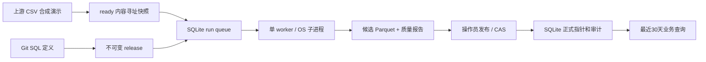

# System Map 与关键风险

[业务契约](01-business-contract.md) → [ADR](adr/001-local-data-product.md) → [代码追溯](03-traceability.md) → [运行手册](04-runbook.md)。

计算过程不写控制数据库或正式指针；子进程仅写当前 run 的候选目录。worker 用 flock 互斥，SQLite BEGIN IMMEDIATE 原子领取；取消由状态标志发给 worker，worker 对当前 Popen 子进程终止并 wait；超时按 monotonic 计时。没有租约、自动重试或第二个日历调度器；macOS launchd 每天触发 daily 固定版本策略，并负责 worker 保活。

worker 子进程继承锁文件描述符，父进程被 SIGKILL 后，仍存活的子进程持锁直到退出；子进程同时检查父进程是否消失。新 worker 获锁后将 RUNNING/CANCELLING 对账为 INTERRUPTED/CANCELLED。孤儿不能发布，未知结果不当成功。机器断电后 OS 释放锁，重启同样对账。只保证本机固定 SQL 执行，不保证任意外部作业取消。

发布先验证候选及质量报告摘要，然后在单 SQLite 事务中检查状态和预期旧指针，更新 delivery 并写 audit。同日期始终一个指针。候选不移动，正式可见性以事务提交为准。文件先 fsync 再记录成功，失败留下未引用文件；不自动 GC，保留回滚与排查依据。应用只写追加内容，摘要检测意外篡改；同 OS 用户可以改数据库，这不是对恶意管理员的安全边界。

查询从只读 SQLite 一次取正式指针，验证每份 Parquet 摘要后用 DuckDB 读取，不 glob 候选目录。磁盘丢失时拒绝读取，不能依靠元数据事务恢复丢失文件。

关键深度问题：跨文件与目录数据库不具备全局事务，采用不可变文件 + 原子元数据指针；复用 SQLite 的原子提交，不实现自制事务。发布 CAS、状态门禁和摘要是本项目业务职责。多机、共享湖表、并发跨引擎写入出现时引入 Iceberg catalog；复杂编排出现时接入 Prefect/Dagster 并删除本地运行队列。

独立审查后：终态写入统一由core.finish_run执行，只有RUNNING/CANCELLING可完成，取消先提交时强制CANCELLED，已中断或已取消的run不接受迟到成功。operations负责worker心跳、策略校验和本地通知outbox；launchd每小时monitor检查UTC昨日交付截止与worker活性。通知内容不包含SQL/源数据/环境变量，失败落盘保留pending以便重放。
